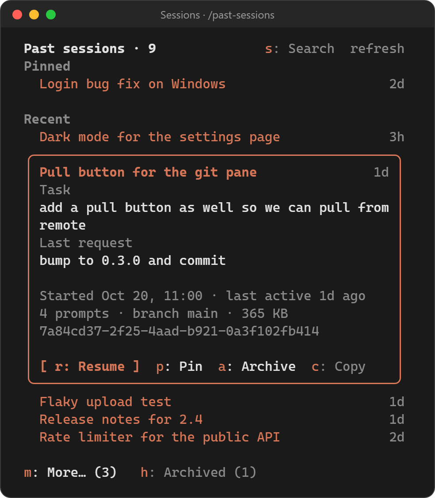

# past-sessions-mod

A Claude Code mod that shows the current project's past sessions in a side pane. Search them by title, prompt or branch, or select a session to see what it was about: its title, the task you started it with, your last request, when it ran, how many prompts it has, and its git branch. From there you can **resume** it as the main session, **pin** it so it always sits on top, or **archive** it so it stops showing.

<p align="center">
  
</p>

<p align="center"><sub>The pane with sample sessions: one pinned, one selected and open in its card, the list collapsed to the newest five.</sub></p>

## Look

- Session titles are drawn in Claude's orange (your theme's `claude` color), so they stand out from labels and dates. Archived sessions, and ones still being read, are dim.
- The selected session opens into a rounded card with its task, last request, when it started and was last active, its prompt count, branch and size, and its actions. **Resume** is the highlighted button; Pin, Archive and Copy sit beside it with their hotkeys.
- While the pane has focus and nothing is open, a hint line at the bottom says how to move around.

## Search

- Press `s` (or **Search**) and type. Every word has to appear somewhere in a session's title, first prompt, last prompt or branch, or at the start of its id. Case doesn't matter.
- Results show every match, not collapsed, newest first with pinned ones on top. Archived matches are listed under **Archived**, so a search finds those too.
- Searching reads every transcript in the project (cached summaries make this quick after the first time). While it reads, the pane says how many are left.
- Enter in the search field opens the top match with **Resume** focused, so Enter again resumes it.
- While the search field has focus, letters go into it rather than to the hotkeys. Tab or Up/Down moves out of it.

## Ordering and collapsing

- Pinned sessions come first, then everything else. Both groups are sorted by date, with the most recently active session on top.
- The list starts collapsed: every pinned session plus the 5 newest others. **More… (n)** shows the rest, and **Less…** collapses the list again.
- Archived sessions are left out of the list. **Archived (n)** shows them at the bottom so you can unarchive one. Archiving a pinned session also unpins it.
- The session you are in now is never listed. Sessions that contain no prompts, or only bare commands like `/clear`, are skipped.

## Install

From the marketplace (both shells):

```text
claude plugin marketplace add netgfx/past-sessions-mod
claude plugin install past-sessions@past-sessions-mod --scope user
```

Or, inside Claude Code: `/plugin marketplace add netgfx/past-sessions-mod`, then `/plugin install past-sessions@past-sessions-mod`, then `/reload-plugins`.

To develop against a checkout:

```bash
# macOS / Linux
claude --plugin-dir ~/src/past-sessions-mod
```

```powershell
# Windows PowerShell
claude --plugin-dir $HOME\src\past-sessions-mod
```

## Use

| Action | How |
|---|---|
| Toggle the pane | `/past-sessions` (or `/past-sessions open`, `/past-sessions close`) |
| Search | `s`, or press **Search**, then type. Enter opens the top match; `x` or **Clear** ends the search. `/past-sessions search <text>` opens the pane already searching |
| Re-read the folder | `/past-sessions refresh`, or press **refresh** in the pane |
| Show a session's details | Click its row, or Tab/Up/Down to it and press Enter |
| Resume / Pin / Archive / Copy | `r` / `p` / `a` / `c` while the pane has focus, or click the buttons |
| More… / Less… | `m` |
| Show / hide archived | `h` |
| Give the pane focus | Click it, or Ctrl+X then Tab. Esc gives focus back to the prompt |

**Resume** runs `/resume <session-id>`, as if you had typed it. If the session can't switch from where you are, the mod copies `claude --resume <session-id>` to the clipboard so you can run it in a terminal. **Copy** always copies that command.

The pane opens on its own when a session starts, but only if it can dock beside the transcript: in the fullscreen terminal layout (`CLAUDE_CODE_NO_FLICKER=1`) or in Claude Desktop's Code tab. To turn that off, set **Open on start** (`auto_open`) to off in `/config`. `/past-sessions` opens the pane in any layout.

## How it works

- It reads `~/.claude/projects/<project>/*.jsonl` (on Windows, `%USERPROFILE%\.claude\projects\...`). If `CLAUDE_CONFIG_DIR` is set, it reads under that folder instead.
- A session's title is its `/rename` name if it has one, otherwise the title Claude Code generated, otherwise the first line of its first prompt.
- Transcripts are read one at a time in the background. When the list is collapsed, only the sessions you can see are read.
- Each summary is cached in the mod's `$.store`, keyed by the file's size and modification time, so a transcript is read again only when it changes. Transcripts over 4 MiB are summarized from their first and last 150 lines: through `powershell` on Windows and `/bin/sh` with `head`/`tail` on macOS and Linux. Their prompt count is shown as a lower bound (`6+ prompts`).
- Pins and archive marks are `$.store` keys (`pin:<id>`, `archive:<id>`). They are shared by every Claude Code session on the machine, so they still apply after you restart.
- The list is re-read every 60 seconds while the pane is open, and after `/clear`, `/resume` or `/branch`.

### Mods API calls

`$.fs.list`, `$.fs.read`, `$.fs.exists`, `$.store.*`, `$.env.get` (`CLAUDE_CONFIG_DIR`, `USERPROFILE`, `HOME`), `$.session.id`/`cwd`/`root`, `$.command.register`, `$.command.run` (`/resume` only), `$.process.run` (only for transcripts over 4 MiB), `$.ui.open`/`close`/`panes`/`copy`/`toast`/`log`/`invalidate`, `$.clock.every`/`after`/`now`. It makes no network calls and writes no files.

## Develop

```text
claude plugin validate .
claude plugin test .
```

The pure logic (parsing, ordering, collapsing) is in `hooks/lib.js`, the drawing is in `hooks/view.js`, and the hooks are in `hooks/register.js`. Tests are in `tests/`.

Tested with Claude Code 2.1.306 on Windows 11. Requires Claude Code 2.1.287 or later.

## License

MIT
